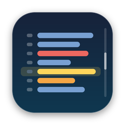
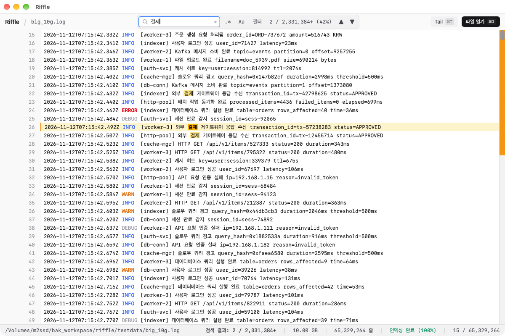
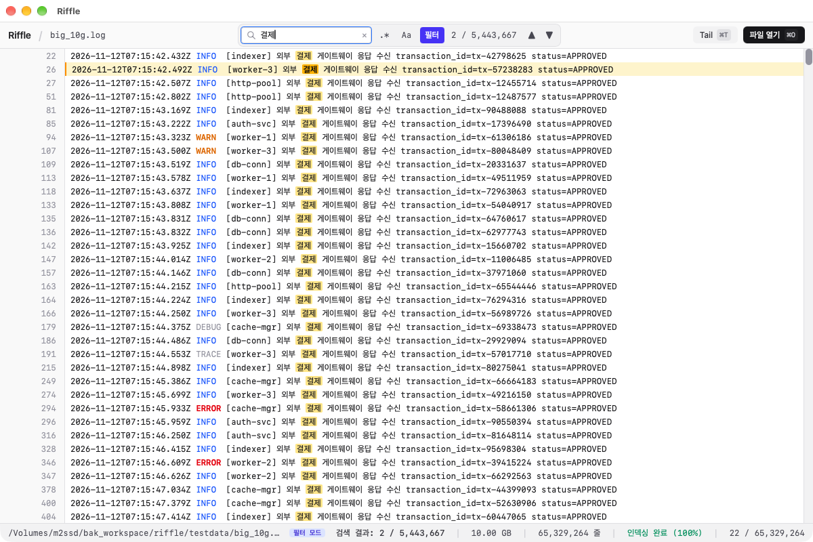
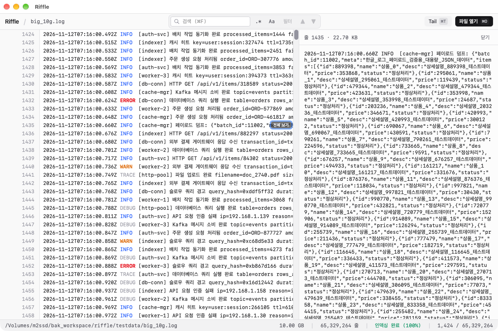

<p align="center">
    
</p>

<h1 align="center">Riffle</h1>

<p align="center">수 GB~수십 GB 로그를 즉시 열고, 부드럽게 스크롤하고, 빠르게 검색하는 macOS 로그 뷰어</p>



텍스트 에디터나 Console 앱이 멈추는 크기의 로그 파일을 위한 읽기 전용 뷰어입니다. 파일 데이터는 Rust 코어에만 두고 화면에 보이는 수백 줄만 UI로 보내기 때문에, 파일 크기와 상관없이 메모리를 적게 쓰고 반응이 빠릅니다.

## 주요 기능

- **즉시 열기:** 전체 인덱싱이 끝나기 전에 첫 화면을 띄우고, 인덱싱 중에도 스크롤할 수 있습니다.
- **빠른 검색:** 리터럴/정규식, 대소문자 구분을 지원합니다. 결과는 찾는 즉시 표시되고, 한글 검색어도 정확한 위치에 하이라이트됩니다.
- **다중 필터:** 로그 레벨 칩과 포함/제외 규칙(리터럴·정규식, AND/OR 결합)으로 보이는 줄을 제한합니다. 규칙별 색상 하이라이트와 프리셋 저장이 가능합니다. CSV/JSONL 파일에서는 특정 컬럼 값에만 규칙을 적용할 수 있습니다.
- **컬럼 뷰:** CSV·JSON Lines 파일을 표로 펼쳐 봅니다. 컬럼 폭 조절·숨기기, 셀 값으로 필터를 지원하며 파일 형식은 자동으로 감지됩니다.
- **검색 결과만:** 검색에 걸린 줄만 모아 봅니다. 왼쪽 거터에는 원래 줄 번호가 그대로 표시됩니다. 필터가 켜져 있으면 필터를 통과한 줄 안에서만 검색합니다.
- **스크롤바 마커:** 검색 결과가 파일 어디에 몰려 있는지 스크롤바에 밀도로 표시합니다.
- **tail 모드:** 파일 끝에 추가되는 줄을 실시간으로 따라갑니다. 위로 스크롤하면 자동 스크롤이 멈추고, 로그 로테이션(rename, truncate)이 감지되면 자동으로 다시 엽니다.
- **압축 로그(.gz) 지원:** gzip 파일을 열면 백그라운드에서 해제하면서 바로 내용을 볼 수 있습니다. 해제된 내용은 임시 공간을 사용하며 파일을 닫으면 해제됩니다. tail 모드는 지원하지 않습니다.
- **로그 레벨 색상:** ERROR, WARN, INFO, DEBUG/TRACE 토큰을 색으로 구분합니다.
- **줄 단위 선택과 대량 복사:** 줄 번호를 클릭하고 Shift+클릭으로 범위를 넓힌 뒤 Cmd+C를 누르면, 10만 줄 이상도 Rust에서 직접 클립보드로 복사합니다.
- **긴 줄 전체 보기:** 16KB가 넘어 잘린 줄은 오른쪽 사이드 패널에서 원문 전체를 볼 수 있습니다.
- **북마크:** 줄에 메모와 색이 있는 표시를 달아 두고 F2로 오갈 수 있습니다. 파일마다 저장되어 다시 열 때 복원됩니다.
- **탭:** 여러 로그 파일을 탭으로 동시에 열어 둘 수 있습니다. 탭마다 인덱싱·검색·필터·tail이 독립적으로 백그라운드에서 계속 진행됩니다. 열린 탭 목록은 앱을 다시 시작해도 복원됩니다.
- **원격 파일(SFTP):** `~/.ssh/config`에 등록된 호스트나 직접 입력한 호스트의 원격 로그 파일을 열 수 있습니다. 원격 파일도 검색·필터·복사·tail(1초 간격 폴링)이 로컬과 동일하게 동작합니다.
- **S3 객체:** `s3://버킷/키` 로그 객체를 다운로드 없이 바로 열 수 있습니다. 버킷·접두사를 탐색하고 여러 객체를 골라 열 수 있습니다(tail 제외).
- **기타:** 줄 번호로 이동, 폰트 크기 조절, 최근 파일 목록, macOS 네이티브 메뉴, `.log`/`.txt` 파일 연결, 시스템 라이트/다크 모드.

| 필터 모드                            | 긴 줄 전체 보기                              |
| ------------------------------------ | -------------------------------------------- |
|  |  |

## 성능

Apple M1(메모리 16GB) 내장 SSD(순차 읽기 약 3.5GB/s)에서 10GB(6,533만 줄) 로그로 측정한 값입니다. 측정 전에 다른 10GB 파일을 읽어 대상 파일을 페이지 캐시에서 밀어낸 상태(콜드)입니다.

| 항목                                        | 결과                                | 목표  |
| ------------------------------------------- | ----------------------------------- | ----- |
| 파일 열기 → 첫 화면(20줄)                   | 1.3ms (인덱싱 완료를 기다리지 않음) | 300ms |
| 전체 줄 인덱싱                              | 3.3초                               | 10초  |
| 리터럴 검색 (544만 건 매치)                 | 3.1~3.3초, 첫 결과 2ms 이내         | 10초  |
| 정규식 검색 (파일 전체 스캔)                | 3.0초                               | —     |
| 10만 줄(16MB) 범위 읽기                     | 약 17ms                             | —     |
| 코어 메모리 (CLI 측정, OS 페이지 캐시 제외) | 인덱싱 38MB, 검색 56MB              | 200MB |

인덱싱과 검색은 디스크 순차 읽기 속도가 상한입니다(같은 파일의 `dd` 읽기 3.07초). 외장 USB SSD(약 670MB/s)에서는 인덱싱 15.4초, 검색 15.3초였습니다.

## 설치

### 요구 사항

- macOS 11 (Big Sur) 이상 (Apple Silicon, Intel 모두 지원)

### 릴리스에서 다운로드 (권장)

[Releases 페이지](https://github.com/kwakchangkyoung/Riffle/releases/latest)에서 Mac에 맞는 DMG를 내려받습니다.

- Apple Silicon(M1 이후): `Riffle_<버전>_aarch64.dmg`
- Intel Mac: `Riffle_<버전>_x64.dmg`

### DMG로 설치

1. 내려받은 DMG를 열고 `Riffle.app`을 `Applications` 폴더로 드래그합니다.
2. 이 앱은 아직 Apple 코드 서명과 공증을 받지 않았습니다. 다른 곳에서 내려받은 DMG라서 처음 실행할 때 "확인되지 않은 개발자" 경고가 나오면, Finder에서 `Riffle.app`을 **우클릭 → 열기**로 한 번 실행하세요. 또는 아래 명령으로 격리 속성을 지울 수 있습니다.

    ```bash
    xattr -dr com.apple.quarantine /Applications/Riffle.app
    ```

### 소스에서 빌드

필요한 도구: [Rust](https://rustup.rs) (stable), Node.js 20 이상, [pnpm](https://pnpm.io), Xcode Command Line Tools

```bash
git clone https://github.com/kwakchangkyoung/Riffle.git
cd Riffle
pnpm install
pnpm tauri build
```

빌드 결과물:

- 앱: `target/release/bundle/macos/Riffle.app`
- 설치 이미지: `target/release/bundle/dmg/Riffle_0.1.0_aarch64.dmg`

```bash
# 앱 설치 후 LaunchServices에 등록 ("다음으로 열기" 목록에 바로 나타나게)
ditto target/release/bundle/macos/Riffle.app /Applications/Riffle.app
/System/Library/Frameworks/CoreServices.framework/Frameworks/LaunchServices.framework/Support/lsregister -f /Applications/Riffle.app
```

## 사용법

### 파일 열기

- **Cmd+O** 또는 상단의 **파일 열기** 버튼
- 로그 파일을 창으로 **드래그 앤 드롭**
- Finder에서 `.log`/`.txt`/`.gz` 파일 **우클릭 → 다음으로 열기 → Riffle**
- 빈 화면의 **최근 파일** 목록, 또는 메뉴 **파일 → 최근 파일**

파일을 열면 첫 화면이 바로 표시됩니다. 하단 상태바에서 인덱싱 진행률과 지금까지 확인된 줄 수를 볼 수 있습니다.

여러 파일을 한 번에 열 수 있습니다. **Cmd+O** 다이얼로그에서 여러 파일을 선택하거나, 여러 파일을 창으로 드래그 앤 드롭하거나, Finder에서 여러 파일을 선택해 Riffle로 열면 각각 새 탭으로 열립니다. 이미 열린 파일을 다시 열면 새 탭을 만들지 않고 그 탭으로 이동합니다.

### 원격 파일 열기

**Cmd+Shift+O**, 메뉴 **파일 → 원격 파일 열기…**, 또는 빈 화면의 **원격 파일 열기** 버튼으로 대화상자를 엽니다.

- `~/.ssh/config`에 등록된 호스트가 목록에 표시되고, 직접 입력(자동완성)도 가능합니다. Riffle은 비밀번호나 개인키를 저장하지 않으며 시스템 `ssh`의 키·agent·known_hosts 설정을 그대로 사용합니다.
- 호스트를 고르면 홈 디렉터리부터 시작해 디렉터리를 탐색할 수 있습니다. 디렉터리를 더블클릭하면 들어가고, 파일을 더블클릭하거나 **열기**를 누르면 탭으로 열립니다.
- 원격 탭에는 호스트 배지(예: `myhost:`)가 표시되고, 상태바에 `원격: host`가 나옵니다. tail 모드는 notify 대신 1초 간격으로 파일 크기를 확인합니다.
- 최초 접속 시 호스트 키를 확인할 수 없거나 인증에 실패하면 안내 메시지가 표시됩니다. 터미널에서 `ssh 호스트명`으로 한 번 접속해 호스트 키를 등록하거나, 암호가 걸린 키는 `ssh-add --apple-use-keychain <키 파일>`로 agent에 등록하세요.

#### 서버 측 가속 (에이전트)

SFTP 원격 파일은 인덱싱·검색·필터 시 파일 전체를 네트워크로 받아야 합니다. 호스트별로 **서버 측 가속(에이전트)**을 켜면, 앱이 원격 `~/.cache/riffle/`에 작은 실행 파일(`riffle-agent-<버전>-<arch>`, 약 2MB)을 SFTP로 올리고 `ssh`로 실행해 인덱싱·검색·필터를 서버에서 직접 수행합니다. 결과(체크포인트·줄 번호·구간)만 돌아오므로 네트워크 전송량이 크게 줄고, 화면에 보이는 줄 읽기는 기존 SFTP 경로를 그대로 씁니다. 원격의 다른 파일은 수정하지 않습니다.

- **호스트별 opt-in, 기본 꺼짐.** 원격 파일 열기 대화상자의 SSH 탭에서 호스트를 고르면 "서버 측 가속(에이전트) 사용" 체크박스가 나타납니다. 설정은 호스트별로 저장됩니다.
- **지원 대상:** 원격 OS가 Linux이고 아키텍처가 `x86_64` 또는 `aarch64`인 경우만 지원합니다. 앱 번들에는 두 Linux 정적 바이너리만 들어 있으므로 macOS 원격 호스트는 지원하지 않습니다.
- **자동 폴백:** 에이전트 설치·실행·버전 불일치·프로토콜 오류·gzip 파일 등 어떤 단계든 실패하면 조용히 일반 SFTP 방식으로 처리하고 탭 상단 안내 바에 사유를 표시합니다. 기능 손실은 없습니다.
- 에이전트로 처리 중인 탭에는 호스트 배지 옆에 ⚡가, 상태바에는 `에이전트` 배지가 표시됩니다.
- **제거:** 원격 호스트에서 `rm -rf ~/.cache/riffle`을 실행하면 에이전트가 완전히 제거됩니다.
- 개발·테스트 시에는 `RIFFLE_AGENT_DIR` 환경 변수로 에이전트 바이너리(`riffle-agent-<arch>`)가 든 디렉터리를 지정할 수 있습니다.

#### S3 객체 열기

원격 파일 열기 대화상자 상단의 **S3** 탭에서 `s3://버킷/키` 객체를 탐색해 엽니다.

- **인증:** AWS 기본 자격 증명 체인(환경 변수, `~/.aws/credentials`, SSO, `aws login`)을 사용합니다. 드롭다운에서 `~/.aws/config`의 프로필을 고를 수 있고, 마지막 선택은 앱 설정에 저장됩니다. Riffle은 자격 증명을 저장하지 않습니다. 자격 증명을 찾을 수 없으면 `aws login` 또는 `aws sso login --profile <이름>` 후 다시 시도하세요.
- **필요한 권한:** 버킷 목록은 `s3:ListAllMyBuckets`, 객체 탐색·열기는 해당 버킷의 `s3:ListBucket`·`s3:GetObject` 권한이 필요합니다. 읽기 전용 호출만 사용하며 쓰기·삭제는 하지 않습니다. 버킷 목록 권한이 없으면 버킷 이름(또는 `bucket/prefix/`)을 직접 입력하거나 즐겨찾기(★)를 쓸 수 있습니다.
- **데이터 전송 요금:** 인덱싱·검색은 객체 전체를 읽으므로 AWS 외부(리전 외/인터넷)로 내보낼 때 전송 요금이 발생할 수 있습니다. 1GB 이상 객체를 열 때는 예상 전송량을 보여주는 확인 창이 뜹니다.
- S3 탭에는 `s3:버킷` 배지와 상태바 `S3: 버킷`이 표시됩니다. S3 객체는 불변이므로 tail 모드는 지원하지 않습니다.

### 탭

상단 탭 바에서 파일을 전환합니다. 탭을 드래그해 순서를 바꾸고, `×` 버튼이나 가운데 클릭으로 닫습니다. 인덱싱 중인 탭은 하단에 얇은 진행률 바가 표시되고, tail 모드가 켜진 탭에는 초록 점이 표시됩니다.

탭을 닫아도 나머지 탭의 인덱싱·검색·필터·tail은 백그라운드에서 계속 진행됩니다. 마지막 탭을 닫으면 최근 파일이 있는 빈 화면으로 돌아갑니다. 열려 있던 탭과 활성 탭은 500ms마다 자동으로 저장되어 다음 실행 때 복원됩니다(메뉴 **Riffle → 시작 시 이전 탭 복원**으로 끌 수 있습니다). 파일별로 보던 스크롤 위치도 기억해 두었다가 같은 파일을 다시 열면 그 위치로 돌아갑니다.

### 로그 병합 보기

여러 로그 파일을 타임스탬프 순으로 섞어 하나의 가상 파일처럼 봅니다. 분산 시스템의 여러 서버 로그를 시간순으로 나란히 따라갈 때 유용합니다.

1. 탭 바 오른쪽의 **병합…** 버튼(파일 탭이 2개 이상 열려 있을 때 활성) 또는 **Cmd+Shift+M**으로 대화상자를 엽니다.
2. 열린 탭(로컬·SFTP·S3 모두 가능) 중 **2~8개**를 체크로 고릅니다. 체크한 목록의 순서가 같은 타임스탬프를 가진 줄의 우선순위가 되며, ↑↓ 버튼으로 순서를 바꿀 수 있습니다.
3. **병합**을 누르면 `병합: a.log + b.log`(원본이 많으면 `병합: a.log 외 N개`)라는 새 탭이 열리고 백그라운드에서 병합 인덱스를 구축합니다. 원본 탭을 닫아도 병합 탭은 계속 동작합니다(병합 시점 스냅샷).

병합 탭에서는:

- 각 줄 왼쪽에 원본별 고정 색 칩(짧은 이름)이 표시되고, 거터에는 원본 파일 기준 줄 번호가 표시됩니다(툴팁에 병합 위치).
- 상단 범례에 원본별 색·이름·줄 수가 표시됩니다. 범례 항목이나 줄의 원본 칩을 클릭하거나 줄을 더블클릭하면 해당 원본 탭으로 전환해 같은 줄로 이동합니다(원본 탭이 닫혀 있으면 다시 엽니다).
- **Cmd+L**에서 줄 번호 외에 `2026-11-12 07:15:42`, `07:15` 같은 시각(로컬 시간대)을 입력해 그 시각의 첫 줄로 이동할 수 있습니다.
- 검색·다중 필터·복사·긴 줄 보기는 일반 탭과 동일하게 동작합니다.
- 북마크, 컬럼 뷰, tail 모드는 지원하지 않습니다(버튼 비활성, 단축키 무시). 원본별 줄 숨기기는 지원하지 않으며, 병합 탭은 세션 복원 대상에 포함되지 않습니다.

### 검색

1. **Cmd+F**로 검색창에 포커스를 옮기고 검색어를 입력합니다. 입력을 멈추면 바로 검색이 시작됩니다.
2. `.*`는 정규식, `Aa`는 대소문자 구분 토글입니다. 정규식이 잘못되면 입력창 아래에 오류가 표시되고 검색은 시작하지 않습니다.
3. **Enter / Shift+Enter**(또는 ▲▼ 버튼)로 다음/이전 결과로 이동합니다. 결과 위치는 `n / N`으로 표시됩니다.
4. **검색 결과만** 버튼을 켜면 검색 결과 줄만 보입니다. 이 보기에서 줄을 더블클릭하면 필터를 끄고 그 줄로 이동합니다. 다중 필터가 켜져 있으면 검색은 필터를 통과한 줄 안에서만 수행됩니다.

### 다중 필터

헤더 아래 필터 바에서 보이는 줄을 제한합니다. 필터는 파일을 바꿔도 유지되며 앱을 다시 시작하면 초기화됩니다.

- **레벨 칩:** ERROR / WARN / INFO / DEBUG / TRACE를 클릭해 켜고 끕니다. 모두 켜진 상태는 조건 없음과 같습니다. Option+클릭은 해당 레벨만 남깁니다.
- **규칙:** `+ 규칙` 입력에 패턴을 넣고 Enter로 추가합니다. `.*`는 정규식, `Aa`는 대소문자 구분, 포함/제외 세그먼트로 규칙 종류를 고릅니다. 규칙 칩을 클릭하면 켜기/끄기, `×`로 삭제, 더블클릭으로 편집합니다.
- **결합 방식:** 켜진 포함 규칙이 2개 이상이면 AND/OR 토글이 나타납니다. 제외 규칙은 켜진 규칙 중 하나라도 매치되면 그 줄을 숨깁니다.
- **색상:** 규칙마다 팔레트에서 색을 고를 수 있고, 매치된 부분이 그 색으로 반투명하게 하이라이트됩니다(검색 하이라이트가 더 위에 표시됩니다).
- **프리셋:** 필터 바 오른쪽 **프리셋** 메뉴에서 현재 필터를 이름으로 저장하고, 목록에서 불러오거나 삭제할 수 있습니다.
- **필드 필터:** 컬럼이 감지된 파일(CSV/JSONL)에서는 규칙 입력창의 **필드** 드롭다운으로 규칙을 특정 컬럼 값에만 적용할 수 있습니다(기본 `전체 줄`). 필드 규칙 칩에는 `필드명=` 접두가 붙고, 컬럼 뷰에서 셀을 우클릭해 바로 규칙을 만들 수도 있습니다.
- 계산은 백그라운드에서 진행되며, 끝날 때까지 이전 결과가 그대로 표시됩니다. 상태바에 `필터: n / 전체줄`과 진행률이 표시됩니다.

### 컬럼 뷰

파일을 열면 앞부분을 표본으로 CSV(구분자 `,` `\t` `;` `|`)/JSON Lines 형식이 자동 감지됩니다. 감지되면 툴바에 **컬럼** 버튼이 나타나고, 버튼이나 **Cmd+Shift+C**로 표 보기를 토글합니다. 보기 설정은 탭별로 유지됩니다.

- 한 줄이 한 행으로 표로 펼쳐집니다. CSV는 따옴표 안의 `""` 이스케이프를 인식하고, JSON Lines는 객체 키를 컬럼으로 씁니다(키가 64개를 넘으면 나머지는 `_extra` 컬럼). 한 줄 = 한 행이 원칙이므로 따옴표 안 줄바꿈이 있는 CSV 레코드는 지원하지 않습니다.
- **헤더:** 맨 위에 고정된 헤더에 컬럼 이름이 표시됩니다. 컬럼 경계를 드래그해 폭을 조절하고(최소 40px, 최대 400px), 헤더 우클릭 또는 오른쪽 **컬럼 ▾** 버튼으로 컬럼을 숨기거나 다시 보입니다. CSV 파일에 헤더 행이 있으면 0번 줄이 흐리게 표시됩니다.
- **필드 필터:** 셀을 우클릭해 **이 값만 보기 / 이 값 제외**를 고르면 그 컬럼 값에 대한 포함/제외 규칙이 필터 바에 추가됩니다.
- 컬럼 폭과 숨김 상태는 파일 경로별로 저장되어 다음에 같은 파일을 열 때 복원됩니다.

### tail 모드

**Cmd+T** 또는 **Tail** 버튼으로 켭니다. 화면이 맨 아래에 있으면 새 줄을 자동으로 따라갑니다. 위로 스크롤하면 자동 스크롤이 일시 정지되고 **새 줄 N개 ↓** 버튼이 나타납니다. 이 버튼을 누르면 다시 맨 아래로 이동합니다. 원격 파일에서는 1초 간격으로 파일 크기를 확인합니다(버튼 툴팁 참조).

### 선택과 복사

- 화면에 보이는 텍스트는 마우스로 드래그해 일반 복사할 수 있습니다.
- 큰 범위는 **줄 번호를 클릭**해 선택하고, **Shift+클릭**으로 범위를 넓힌 뒤 **Cmd+C**를 누릅니다. 선택 범위는 거터와 본문에 함께 표시되고, 상태바에 `선택: N줄 · ⌘C 복사`가 나옵니다. 복사가 끝나면 `n줄 복사됨 (크기)`가 표시됩니다. 한 번에 최대 100MB까지 복사할 수 있습니다.
- 일반 보기에서 **Cmd+A**로 파일 전체를 선택할 수 있습니다(검색 결과만/필터 보기는 지원하지 않습니다).
- **Esc**로 선택을 해제합니다.

### 긴 줄 보기

16KB가 넘는 줄은 화면에서 잘려 보이고, 줄 번호 오른쪽에 **↔** 아이콘이 붙습니다. 아이콘을 클릭하거나 줄을 더블클릭하면 사이드 패널에서 원문 전체를 볼 수 있습니다(최대 10MB).

### 북마크

줄에 북마크(색상 + 메모)를 달아 두면 파일마다 저장되어 다음에 열 때 그대로 복원됩니다.

- **토글:** **Cmd+B**를 누르면 현재 줄에 북마크가 생기고, 이미 있으면 지워집니다(대상 줄: 줄 선택이 있으면 선택 시작 줄, 없으면 현재 검색 결과 줄, 없으면 화면 위 1/3 지점 줄). 줄 번호를 **우클릭**하거나 **Option+클릭**해도 됩니다. 북마크가 있으면 거터에 색 점이, 스크롤바에 색 마커가 표시됩니다.
- **이동:** **F2 / Shift+F2**(또는 **Cmd+Option+↓ / ↑**)로 다음/이전 북마크로 순환 이동합니다.
- **목록:** **Cmd+Shift+B**로 오른쪽 북마크 패널을 엽니다. 항목을 클릭하면 그 줄로 이동하고, 메모를 편집하거나 6가지 색을 고르거나 삭제할 수 있습니다.
- 저장한 뒤 파일 내용이 바뀌면(로테이션 등) 탭 상단에 안내가 표시됩니다. **[확인]**을 누르면 현재 파일 기준으로 다시 저장되어 위치가 맞춰집니다.

### 단축키

| 키                           | 동작                                 |
| ---------------------------- | ------------------------------------ |
| Cmd+O                        | 파일 열기 (여러 파일 선택 가능)      |
| Cmd+Shift+O                  | 원격 파일 열기                       |
| Cmd+W                        | 탭 닫기                              |
| Cmd+Shift+M                  | 열린 탭 로그 병합 (2~8개)            |
| Cmd+1~8                      | 해당 순번 탭으로 이동                |
| Cmd+9                        | 마지막 탭으로 이동                   |
| Ctrl+Tab / Ctrl+Shift+Tab    | 다음 / 이전 탭                       |
| Cmd+Shift+[ / Cmd+Shift+]    | 이전 / 다음 탭                       |
| Cmd+F                        | 검색창 포커스                        |
| Cmd+Shift+F                  | 필터 규칙 입력창 포커스              |
| Enter / Shift+Enter          | 다음 / 이전 검색 결과                |
| Cmd+L                        | 줄 번호로 이동                       |
| ↑ ↓ / PageUp PageDown        | 한 줄 / 한 화면 스크롤               |
| Cmd+↑ / Cmd+↓ (Home / End)   | 파일 처음 / 끝                       |
| Cmd+T                        | tail 모드 토글                       |
| Cmd+Shift+C                  | 컬럼 뷰 토글 (CSV / JSONL 파일)      |
| Cmd+B                        | 현재 줄 북마크 추가/제거             |
| F2 / Shift+F2                | 다음 / 이전 북마크                   |
| Cmd+Option+↓ / ↑             | 다음 / 이전 북마크                   |
| Cmd+Shift+B                  | 북마크 목록 패널                     |
| 줄 번호 우클릭 / Option+클릭 | 북마크 토글                          |
| 줄 번호 클릭 / Shift+클릭    | 줄 선택 / 범위 선택                  |
| Cmd+A                        | 전체 줄 선택 (일반 보기)             |
| Cmd+C                        | 선택한 줄 복사                       |
| Cmd+= / Cmd+- / Cmd+0        | 글자 크게 / 작게 / 기본 크기         |
| 트랙패드 핀치                | 글자 크기 조절                       |
| Cmd+/                        | 단축키 도움말                        |
| Esc                          | 검색창 해제, 줄 선택 해제, 패널 닫기 |

## 자동 업데이트

앱이 GitHub Releases의 `latest.json`을 확인해 새 버전을 알려줍니다.

- **시작 시 자동 확인:** 앱 실행 후 3초 뒤 백그라운드에서 확인합니다. 새 버전이 있을 때만 다이얼로그가 표시되고, 최신 버전이거나 네트워크 오류면 아무 표시 없이 지나갑니다.
- **수동 확인:** 메뉴 **Riffle → 업데이트 확인…** 을 누르면 결과(최신 버전 / 새 버전 / 오류)가 항상 표시됩니다.
- **끄기:** 메뉴 **Riffle → 시작 시 업데이트 자동 확인** 의 체크를 해제합니다.
- 다이얼로그에서 **업데이트**를 누르면 다운로드와 설치가 진행됩니다. 완료 후 **지금 재시작**을 누르면 새 버전으로 다시 시작합니다.

참고: 자동 업데이트는 이 기능이 포함된 릴리스부터 동작합니다. v0.2.0 이하 버전을 쓰고 있다면 한 번은 DMG를 수동으로 설치해 새 버전으로 올린 뒤부터 자동 업데이트를 사용할 수 있습니다.

## 릴리스 방법 (메인테이너용)

버전 태그를 push하면 GitHub Actions(`.github/workflows/release.yml`)가 Apple Silicon과 Intel용 DMG를 빌드해 릴리스에 첨부합니다. 자동 업데이트용 업데이터 산출물(`.app.tar.gz` + `.sig`, `latest.json`)도 함께 만들어집니다. 또한 `agents` 잡이 `x86_64`·`aarch64` Linux musl 정적 에이전트 바이너리를 빌드해 앱 번들 리소스(`agents/`)에 포함합니다.

업데이터 산출물을 서명하려면 저장소 Secrets에 서명 키 2개가 필요합니다.

- `TAURI_SIGNING_PRIVATE_KEY`: `pnpm tauri signer generate`로 만든 개인키 내용
- `TAURI_SIGNING_PRIVATE_KEY_PASSWORD`: 개인키 비밀번호

공개키는 `src-tauri/tauri.conf.json`의 `plugins.updater.pubkey`에 들어 있습니다. 키를 새로 만들면 함께 갱신해야 합니다. Secrets가 없으면 릴리스 워크플로가 실패합니다.

1. `CHANGELOG.md`에 `## [새 버전] - 날짜` 절을 추가합니다. 이 내용이 릴리스 노트와 앱 내 업데이트 알림에 그대로 표시되며, 절이 없으면 워크플로가 실패합니다.
2. 세 곳의 `version`을 새 버전으로 올리고 커밋합니다: `src-tauri/tauri.conf.json`, `package.json`, 루트 `Cargo.toml`의 `[workspace.package]` (모든 crate와 에이전트가 이 값을 공유합니다).
3. 같은 버전의 태그를 만들어 push합니다. 태그와 `tauri.conf.json` 버전이 다르면 워크플로가 실패합니다.

    ```bash
    git tag v0.2.0
    git push origin main v0.2.0
    ```

4. 진행 상황은 저장소의 **Actions** 탭에서 확인합니다. 빌드가 끝나면 **Releases**에 DMG가 올라갑니다.

## 개발

```bash
pnpm install
pnpm tauri dev          # 개발 모드 실행

# 검증 명령
cargo fmt --all --check
cargo clippy --workspace --all-targets -- -D warnings
cargo test --workspace
pnpm typecheck
pnpm lint
```

테스트용 대용량 로그는 생성기로 만듭니다(`testdata/`는 git에서 제외됩니다).

```bash
cargo run -p riffle-core --release --example gen_log -- testdata/big_10g.log 10G
# tail 모드 테스트: 초당 5,000줄 추가 + 20초마다 로테이션
cargo run -p riffle-core --release --example append_log -- testdata/tail.log --rate 5000 --rotate-every 20
```

### 구조

```
crates/riffle-core/   순수 Rust 코어: 파일 읽기(read_at), 희소 줄 인덱스, 줄 읽기, 검색, tail(refresh)
src-tauri/            Tauri 앱: IPC 커맨드, 파일 감시, 네이티브 메뉴, 최근 파일
src/                  React + TypeScript UI: 가상 스크롤, 커스텀 스크롤바, 검색바
docs/SPEC.md          요구사항과 설계 문서
```

자세한 설계는 [`docs/SPEC.md`](docs/SPEC.md)를 참고하세요.
